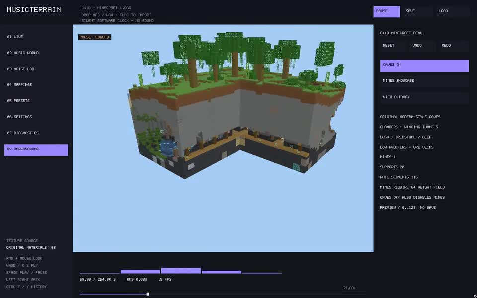

# MusicTerrain × C418《Minecraft》完整动态演示

🤖 Agent: OpenAI Codex 应仓库所有者要求上传此演示。

[**下载完整 MP4（11.6 MB，4 分 14 秒，含原曲音频）**](https://github.com/kaliwell/MusicTerrain/raw/refs/heads/demo-videos/MusicTerrain-C418-Minecraft-compressed.mp4)

- 分辨率：960×600；格式：H.264 MP4。
- 使用用户提供的 C418《Minecraft》音频，保留完整双声道音轨。
- 内容：音乐驱动地形、丛林、洞穴剖面、废弃矿井和村庄视角切换。
- 音乐：C418；可视化：MusicTerrain；代码版本：`b57204348`。

点击视频链接下载后即可播放。本分支只存放演示文件；主代码分支 `main` 未修改。
仓库为私有，需要登录有访问权限的 GitHub 账号。
