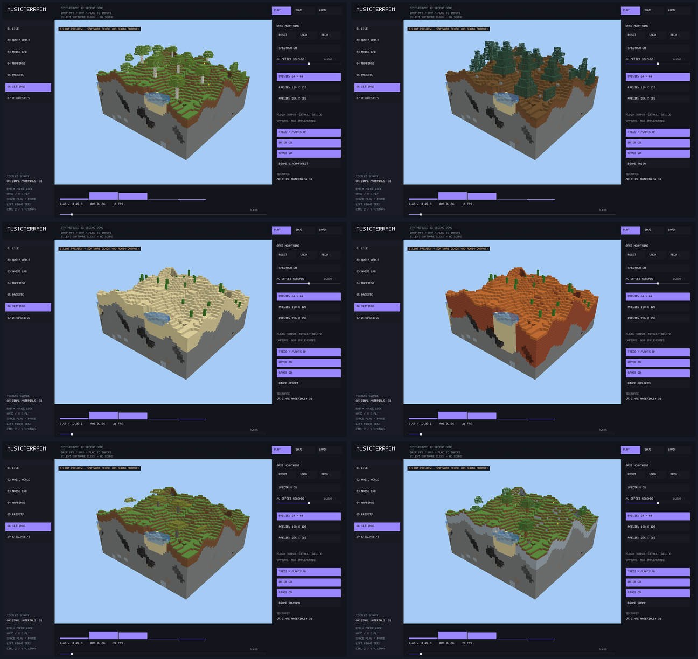
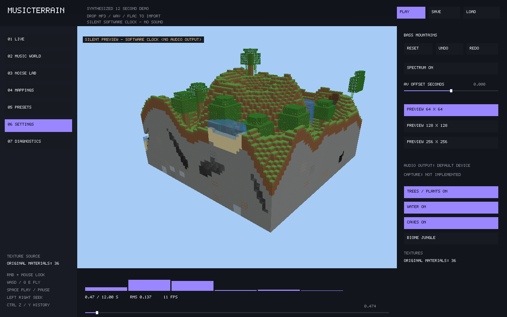

# Preview biomes

MusicTerrain now has eleven preview biomes. These are seeded, original scene rules,
not a port of Minecraft's biome registry or vanilla feature placement.



The comparison uses actual native renderer screenshots at one paused audio time,
with the same Seed, terrain parameters, camera, caves and ponds. In reading order:
birch forest, taiga, desert, badlands, savanna, swamp. Only the biome selector changed.

| Biome / CLI name | Surface and subsoil | Decoration |
| --- | --- | --- |
| Meadow / `meadow` | Grass / dirt | Sparse oaks, grass, poppies, dandelions |
| Forest / `forest` | Grass / dirt | Denser oaks, grass and flowers |
| Alpine / `alpine` | Snow / stone | Scattered rocks |
| Shore / `shore` | Sand / sand | Bare banks |
| Birch forest / `birch-forest` | Grass / dirt | White birch bark, taller trunks, yellow-green leaves |
| Taiga / `taiga` | Podzol / dirt | Tall spruce, dark conical crowns, rocks |
| Desert / `desert` | Sand / deep sand | 2–4-block cacti and cutout dead bushes |
| Badlands / `badlands` | Red sand / 12-block terracotta subsoil | Cacti and dead bushes |
| Savanna / `savanna` | Grass / dirt | Sparse acacias, gray bark, warm leaves, flat wide crowns, grass |
| Swamp / `swamp` | Grass / clay | Oaks, flowers and clay exposed around existing ponds and caves |
| Jungle / `jungle` | Grass / dirt | Mixed ordinary/giant jungle trees, broad crowns, vines, bamboo, bushes, cocoa, melons and ferns |



## Use

Open **Settings** and click **BIOME AUTO** to cycle through the eleven biomes and
back to automatic distribution. Each change increments the generation revision;
older jobs cannot overwrite the selection, and biome is part of the mesh cache key.

```sh
cargo run -p musicterrain -- demo --biome jungle
cargo run -p musicterrain -- demo --biome desert
cargo run -p musicterrain -- demo --biome taiga
cargo run -p musicterrain -- preview --audio song.wav --biome birch-forest
cargo run -p musicterrain -- demo --biome auto
```

CLI names are exact lowercase names from the table. Unknown names fail before
opening a window. Audio mapping, time controls and other scene switches remain
available. Selection is a scene option, not part of the existing terrain preset
JSON; restart with `--biome` to restore it. Scene switches currently have no undo.

## Determinism and bounds

Automatic selection uses Horizon's seeded Simplex noise for moisture (0.011 per
block) and a decorrelated temperature sample (0.006 per block). Water-adjacent
heights at or below 9 choose Shore, and sufficiently high ground chooses Alpine.
Hot regions with moisture above 0.45 choose Jungle.
The remaining temperature/moisture thresholds select the nine lowland types.
A forced selection overrides climate and altitude, while actual low water banks
retain sand. No wall clock, callback order or worker scheduling enters ecology.

Biomes change surface layers, species, canopy geometry and decoration density.
They share the existing audio-driven height/density field and pond/cave network;
this update does not implement separate biome terrain-height rules, swamp water
simulation, animal entities, collision or persistent Minecraft saves.

All trees fit the expanded radius-5 tree query halo; spruce trunks are 8–10 blocks,
birch trunks 6–8, oak/acacia trunks 4–6, jungle trunks 12–17.
Jungle uses a 96% tree-cell acceptance rate versus Forest's 78%; slope, cave
and water safety checks still apply. Giant jungle crown radius reaches five blocks;
four seeded vine strands hang 3–6 cells beneath the canopy. Vines use crossed
cutout planes, not Minecraft's attachment block states or climbing physics.
Shared edge anchors keep stable event IDs.
Decoration requests retain their 256-block limit and bounded world-cell grids.

Fourteen original pixel-art layers were appended to the original 17 material IDs,
so older indices retain their meaning. The jungle update appends another five
layers (36 at that stage; now 54 total with village and understory materials): jungle bark, end grain, leaves, vine and fern. Birch/spruce/acacia trunks and leaves,
red sand, terracotta, podzol, cactus and dead bush also accept matching local PNGs.
No proprietary textures are included.

## Verification

The added tests cover automatic reachability of every lowland biome, seed
repeatability/difference, species and soil contracts, whole/tiled layout equality
for all seven added biomes, distinct real material meshes and repeated checksums.
The X11 harness accepts `--biomes` to click every selection, wait for real mesh
uploads and capture screenshots; it also restores Auto. Results are recorded in
[TEST_REPORT](TEST_REPORT.md).

[Current richer ecology and village implementation](WORLD_DETAILS.md).
