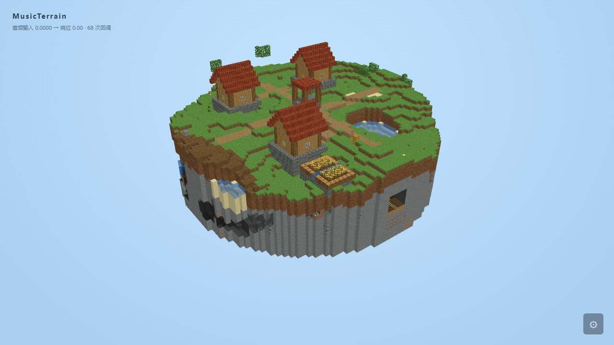

# MusicTerrain 网页壁纸

这是 Wallpaper Engine 的 **Web 类型**项目：Rust/WASM 生成体素和网格，
网页使用 WebGL 2 绘制，音频通过 Wallpaper Engine 的频谱回调接入。
运行壁纸时不需要 EXE、本地服务器、麦克风、Node 或 Rust 工具链，也不请求联网资源。



## 使用

本机项目已构建时，双击根目录 `Start-MusicTerrain-Web.cmd` 可在 Wallpaper Engine 中打开。
加 `-Preview` 可打开独立预览窗口。安装目录不在默认 Steam 库时，可使用
`-WallpaperEngine "E:\SteamLibrary\steamapps\common\wallpaper_engine"`。

分享导入包：`dist/MusicTerrain-Web.zip`。解压为独立文件夹，整体复制到 Wallpaper Engine
安装目录的 `projects/myprojects/`，保留包内的 `project.json` 和自定义属性，
再在“已安装”列表选择本项目。也可在编辑器“创建壁纸”入口导入 `index.html`。
不要导入整个 Rust 仓库。
所有运行文件都位于 `dist/MusicTerrain-Web`，可以离线复制使用。
原始程序设置面板默认隐藏，通过 Wallpaper Engine 的属性栏调整参数。

支持：

- 32 / 64 / 96 / 128 范围，一格体素精度，默认 64。
- 方柱、圆柱、六边形柱、菱形柱；八种原有噪波。
- 系统音乐响应、W 维洞穴演化、洞顶和底层保护。
- 自动环绕、正交/透视、视角缩放、天空颜色。
- 简化树木、草地/泥土/岩石/沙地/雪和半透明水体。
- Wallpaper Engine 全局 FPS、暂停/恢复和音频开关。

普通浏览器只提供预览，不会获取系统声音。“模拟音乐”是明确标注的无声测试输入；
在 Wallpaper Engine 中使用真实系统音频，并隐藏该测试按钮。
不保存音频或频谱，壁纸自身不会播放声音。
普通浏览器开发预览需通过本地 HTTP 服务打开，以符合 Worker 的来源限制；
Wallpaper Engine 导入后直接加载本地项目，不需要服务器。

## 构建

需要现有 Rust 工具链及 WASM 目标，开发验证另需 Node；使用者不需要这些工具。

```powershell
rustup target add wasm32-unknown-unknown
powershell.exe -NoProfile -ExecutionPolicy Bypass -File tools\build-musicterrain-web.ps1
# 同时安装为本机新项目；已有同名目录时创建新目录，不覆盖用户项目。
powershell.exe -NoProfile -ExecutionPolicy Bypass -File tools\build-musicterrain-web.ps1 -Install
```

打包脚本只复制 `web/musicterrain` 中的独立运行文件、许可证和生成的 WASM。
WASM 嵌入本地 `kernel-base64.js`，避免 `file://` 下额外的 WASM fetch/MIME 限制。
包中不包含 Minecraft 资源，也没有 CDN 或原生程序桥接。

## 实现

`crates/musicterrain-web` 使用 `musicterrain` 的非 native 构建，复用 `TerrainField`、
八种噪波、`MappingGraph`、`Ecology`、`UndergroundField`、`TerrainShape` 和公共的
`caves::cave_slice`。4D 洞穴函数也供原生预览使用。

WASM 在一个 Web Worker 中执行。只允许一个网格任务执行，属性版本变化后丢弃旧结果。
传输网格使用可转移缓冲区，暂停时停止调度；渲染与地形更新分开运行。
更新间隔同时受用户上限和最近生成耗时约束，避免大范围占满后台 CPU。
贪心矩形合并只合并同一平面、同一材质和同一亮度的方块面，UV 按方块重复，
保留体素轮廓；没有顶点形变或实验补帧。

Wallpaper Engine 提供的是双声道各 64 个频谱幅值，并非 PCM。
网页把它们聚合为低/中/高频及整体强度估计，不能等同于原生 FFT 的精确 RMS/频段。
音频停止或回调中断后强度归零；音乐参数仍使用共享的 attack/release 映射。
默认启用自动音频归一化，使用快速跟随、缓慢释放的公共增益，保留节拍起伏，
避免 QQ 音乐等较弱或稀疏的频谱经过映射后几乎不可见。
整体强度也驱动地形振幅，因此低频较少的音乐仍可响应。
可调整“音频灵敏度”或关闭自动归一化；设置面板会显示原始输入与实际响应值。

## 首版边界

这是精简移植：树木使用简化几何；村庄、矿井、完整群落装饰、本地音乐解码、
原生预设 JSON 导入和世界导出尚未接入。高度为 Y0..96，地表上限 80。
水体为静态填充，没有流体模拟；透明水面没有逐三角形距离排序。
128 为高负载选项，不能把相机 FPS 当作地形更新频率。

## 验证

```powershell
cargo test --locked -j4 -p musicterrain -p musicterrain-web
cargo clippy --locked -j4 -p musicterrain -p musicterrain-web --all-targets -- -D warnings
node --test tools/test-musicterrain-web.cjs
# 需要本机 Edge；Playwright 仅作为开发依赖安装到忽略的 run 目录。
npm.cmd install --prefix run/validation/web-tools --no-save playwright
node tools/verify-musicterrain-web.cjs
```

浏览器测试验证实际 WASM 加载和 WebGL 绘制、音频回调、属性切换、四种外形、
暂停冻结、静音归零、10 FPS 限制和超宽屏/128 范围。音频接口使用测试频谱注入，
不代表已经测量真实系统音频端到端延迟。
证据位于 `run/validation/web-browser`，截图为实际浏览器画面。

2026-10-31 验证结果：105 项原生/共享内核测试、4 项网页 Rust 内核测试、
4 项 JavaScript 桥接/相机测试及 Edge 集成检查通过，Clippy 警告视为错误检查通过。
弱音回归使用仅两个频点、幅值 0.002 的测试频谱，验证它能驱动真实 WASM 地形变化，
并验证静音归零、较弱音量可检测及释放阶段保留强弱起伏。
生成的 WASM 没有宿主导入。已通过命令行安装、打开 Wallpaper Engine 项目及预览窗口，
配置中确认选中了本项目，验证期间没有新增引擎加载日志错误。
Windows 界面自动化连接不可用，因此画面检查使用真实浏览器截图，
没有把模拟频谱测试声称为 Wallpaper Engine 实机音频延迟验收。

官方接口参考：
[音频频谱](https://docs.wallpaperengine.io/en/web/audio/visualizer.html)、
[属性与暂停](https://docs.wallpaperengine.io/en/web/api/propertylistener.html)、
[FPS 限制](https://docs.wallpaperengine.io/en/web/performance/fps.html)、
[导入网页壁纸](https://docs.wallpaperengine.io/en/web/first/gettingstarted.html)。
