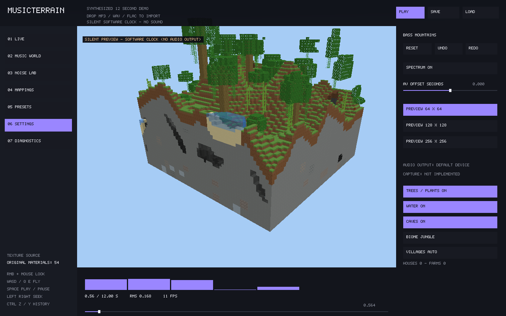
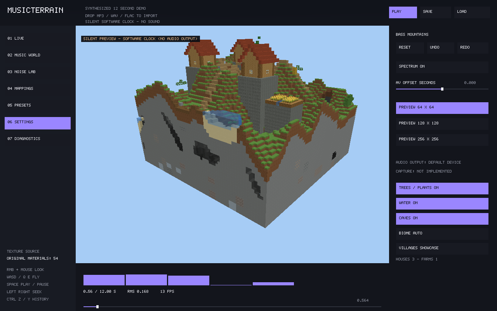

# Rich ecology and village preview

This update adds biome-specific detail to MusicTerrain's existing isolated scene.
It references Minecraft's recognisable ecology and building vocabulary, while
using original geometry/artwork and Horizon's production mesh/renderer formats.
These are original preview rules, not a vanilla feature or jigsaw parity port.



## Ecology layers

- Jungle mixes 5–9-block ordinary trees and 12–17-block giants. Giants have 2×2
  trunks and irregular rounded crowns up to radius five; smaller crowns and bushes
  create lower layers. Bamboo grows in seeded patches of three narrow cutout
  stalks, with ferns, rare melons and cocoa pods attached to trunk sides. Vines
  and denser original leaf artwork remain cutout surfaces.
- Forest has bushes, red/brown mushrooms and rare pumpkins among grass/flowers.
  Birch forest adds undergrowth and flowers; meadow has sunflowers and pumpkins.
- Taiga mixes spruce, ferns, mushrooms, bushes and rocks. Savanna mixes acacias,
  bushes and grass. Swamp has mushrooms, bushes and ferns. Sugar cane is reserved
  for sampled banks adjacent to the nominal water level; not every elevated pond
  currently receives cane. Desert/badlands retain their cactus/dead-bush palette;
  alpine retains snow/rocks.
- Trees query a five-block halo, bushes two and bamboo one. Each generated block
  or quad is clipped independently. Shared anchors and IDs are independent of
  request order. Natural giant crowns may touch/overlap; anchors stay separated.
- Jungle permits somewhat steeper slopes than other forests (4.5-block versus
  2.75-block height difference over two blocks), while retaining water/cave checks.



## Villages

Settings now includes **VILLAGES AUTO / SHOWCASE / OFF**. Each edit invalidates
mesh cache identity and generation revisions. CLI:

```sh
cargo run -p musicterrain -- demo --biome jungle --villages off
cargo run -p musicterrain -- demo --biome meadow --villages showcase
cargo run -p musicterrain -- demo --biome desert --villages showcase
cargo run -p musicterrain -- demo --biome taiga --villages showcase
```

Auto uses seeded 192-block world cells, bounded jitter and eligible meadow,
desert, savanna, taiga or alpine terrain. Jungle, swamp and ordinary forests do
not receive natural villages. Showcase is an explicit original preview layout
anchored at world origin; it may be placed in any selected biome. It is never
anchored to the request or camera, preserving clipped-generation consistency.

A valid full plan contains at least two of four house plots, a crossroads,
terrain-following paths, a central covered well and, where ground permits, an
irrigated farm with wheat and hay details. Houses contain genuinely empty rooms,
open doorways, windows and roofs; cobblestone foundations connect to sampled
terrain rather than leaving floating floors. Desert uses flat sandstone roofs,
Taiga/Alpine spruce, Savanna acacia posts and warm roofs, other styles oak.
Some layouts include chimneys. These do not emit simulated smoke or block light.

Plots reject invalid/underwater/extreme-height ground and excessive slopes.
Foundations on sloped musical terrain can be tall; this iteration does not
flatten the wider landscape or place Minecraft's exact village structures.
Steep surfaces may have fewer buildings or no valid village. Full global plans
are evaluated before clipping, so a small region cannot change layout decisions.

Village materials enter the temporary terrain volume before face meshing, avoiding
coplanar road/foundation overlays. Vegetation is excluded from reserved plots,
preventing trees growing through houses. Water OFF also removes well/farm water;
vegetation OFF removes crops, while buildings have their own mode control.
Village statistics report visible/intersecting plans and plots, not inhabitants.

## Budgets and limits

Requests are bounded to 256 blocks, at most 150,000 planned village blocks,
bounded decoration grids and the existing one-running/one-pending/one-result
worker. Plans and plot loops check cancellation; expired revisions are discarded.
Larger extents retain existing voxel LOD for terrain. Villages are suspended at
128/256 extents to preserve one-block walls/windows and hollow rooms rather than
collapse them into coarse cells. Select 64×64 for villages. Floating
island/strong density previews suspend villages rather than place unsupported
buildings in air; use a height-field preset for the village showcase.

There are 54 original material layers. All old IDs remain stable. Local resource
PNG replacement is supported but no Mojang images/templates are included.
No new runtime dependencies or ordinary Horizon worldgen/gameplay changes.

This is visual content: villagers/animal AI, vine climbing, crop growth, crafting,
collision, block-light updates and Minecraft save/reopen remain unimplemented.
Scene options are runtime/CLI settings, not part of the current preset JSON or
parameter Undo/Redo. The analysis CLI continues to export the core height field,
not this decorated preview.

## Verification

Tests cover feature/species distribution, water safety, bounded requests, all
material alpha/layers, actual jungle bamboo/melon/cocoa/fern geometry, hollow
house/door/window/road/farm content, village style/eligibility/cancellation,
whole-versus-tiled village blocks/crops, mesh switches and section coordinates.
Actual UI tests cycle all biomes and village modes. See [TEST_REPORT](TEST_REPORT.md)
and [PERFORMANCE](PERFORMANCE.md) for raw results and software-GPU measurements.
